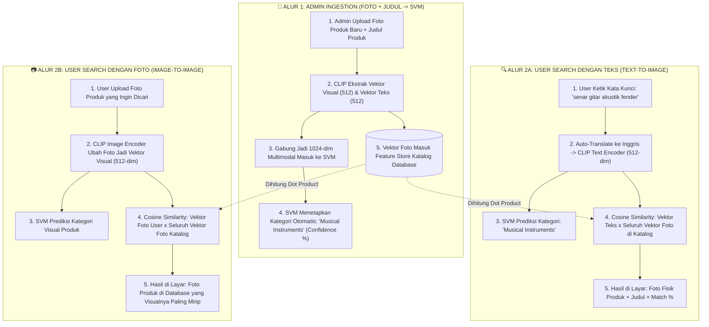

# 📘 RANGKUMAN LENGKAP: ARSITEKTUR MULTIMODAL CLIP & SVM UNTUK RETAIL DORMIY
> **Catatan Panduan Konsep & Alur Kerja Sistem**  
> Ditulis dengan bahasa yang sederhana, analogi nyata, dan matematika dasar berdasarkan hasil diskusi dan eksperimen training.

---

## 📑 DAFTAR ISI
1. [Hakekat Dasar: Apakah CLIP & SVM Punya Akal Pikiran?](#1-hakekat-dasar-apakah-clip--svm-punya-akal-pikiran)
2. [Rahasia Angka: Bagaimana CLIP Mengubah Gambar & Teks Menjadi Vektor 512 Angka](#2-rahasia-angka-bagaimana-clip-mengubah-gambar--teks-menjadi-vektor-512-angka)
3. [Bagaimana Cara Menghubungkan CLIP dan SVM? (Multimodal Fusion 1024-dim)](#3-bagaimana-cara-menghubungkan-clip-dan-svm-multimodal-fusion-1024-dim)
4. [Bagaimana Cara SVM Tahu Siapa Masuk Kategori Mana?](#4-bagaimana-cara-svm-tahu-siapa-masuk-kategori-mana)
5. [Evaluasi Training: Mengapa Dulu Sempat Drop ke 20% dan Bagaimana Cara Memperbaikinya?](#5-evaluasi-training-mengapa-dulu-sempat-drop-ke-20-dan-bagaimana-cara-memperbaikinya)
6. [Tiga Alur Kerja Nyata (Three Distinct Workflows)](#6-tiga-alur-kerja-nyata-three-distinct-workflows)
   - [Alur 1: Admin Memasukkan Produk Baru (Auto-Categorization & Indexing)](#alur-1-admin-memasukkan-produk-baru-ke-database)
   - [Alur 2A: Pengguna Mencari via Teks (Text-to-Image Semantic Search)](#alur-2a-pengguna-mencari-produk-menggunakan-teks-text-to-image)
   - [Alur 2B: Pengguna Mencari via Foto Produk (Image-to-Image Visual Search)](#alur-2b-pengguna-mencari-produk-menggunakan-foto-image-to-image)

---

## 1. Hakekat Dasar: Apakah CLIP & SVM Punya Akal Pikiran?

> **Jawabannya: TIDAK! Baik CLIP maupun SVM tidak paham arti kata atau bentuk gambar seperti manusia.**

* **CLIP (Contrastive Language-Image Pretraining)**:
  * Dilatih oleh OpenAI menggunakan **400 juta pasang gambar dan teks** dari internet.
  * CLIP **tidak menyimpan gambar**. CLIP hanyalah sebuah **"penerjemah pintar"**.
  * Jika diberi **Gambar**, CLIP mengeluarkan deretan **512 angka desimal** (disebut *Image Vector*).
  * Jika diberi **Teks**, CLIP juga mengeluarkan deretan **512 angka desimal** (disebut *Text Vector*).
  * Sifat dasarnya adalah **Self-Supervised / Weakly Supervised**: ia belajar sendiri dari teks caption internet tanpa perlu manusia melabeli kategori secara manual.
* **SVM (Support Vector Machine)**:
  * Awalnya **buta total**. SVM tidak tahu apa itu *Stationery*, *Panci*, atau *Hardware*.
  * Sifat dasarnya adalah **Murni Supervised Learning (Terbimbing)**: SVM belajar murni dari data latihan yang **KITA** beri tahu jawabannya (*Ground Truth Label* pada 17 Kategori Bersih Amazon).

---

## 2. Rahasia Angka: Bagaimana CLIP Mengubah Gambar & Teks Menjadi Vektor 512 Angka?

### Kenapa kata `"Pulpen Gel"` bisa cocok dengan `"Stationery / Alat Tulis"`, padahal katanya berbeda?
Komputer tidak melihat huruf. Komputer mengubah makna kata menjadi deretan 512 angka:
* **Vektor "Black Gel Pen"** = `[-0.0005, 0.0028, -0.0560, 0.0213, ...]`
* **Vektor "Stationery / Writing Tools"** = `[-0.0266, -0.0189, -0.0076, 0.0091, ...]`
* **Vektor "Hardware Power Drill" (Bor)** = `[-0.0259, 0.0002, -0.0264, 0.0030, ...]`

### Bagaimana Cara Komputer Mengujinya? (Perkalian Dot Product)
Komputer mengalikan angka ke-1 dengan ke-1, ke-2 dengan ke-2, lalu menjumlahkan semuanya:
$$\text{Skor Kemiripan} = (A_1 \times B_1) + (A_2 \times B_2) + \dots + (A_{512} \times B_{512})$$

* **Hasil Nyata dari Komputer**:
  * $\text{Pulpen Gel} \times \text{Stationery} = \mathbf{0.7409}$ (Angka Besar $\rightarrow$ **Sangat Cocok!**)
  * $\text{Pulpen Gel} \times \text{Hardware Drill} = \mathbf{0.7081}$ (Angka Lebih Kecil $\rightarrow$ **Kurang Cocok**)

Karena nilainya lebih besar, sistem langsung tahu bahwa pulpen gel jauh lebih berkaitan dengan alat tulis dibanding bor tembok.

---

## 3. Bagaimana Cara Menghubungkan CLIP dan SVM? (Multimodal Fusion 1024-dim)

Kunci terbesarnya adalah: **Shared Multimodal Space (Satu Ruang yang Sama)**.
* Di model biasa, teks dan gambar memiliki bahasa angka yang berbeda dan tidak bisa disatukan.
* Di CLIP, **vektor teks dan vektor foto dibuat memiliki format koordinat yang sama persis** (masing-masing 512-dimensi).

### Mengapa Kita Menggabungkannya Menjadi 1024-dimensi untuk SVM?
Saat melatih SVM, gambar saja terkadang ambigu (contoh: botol sampo vs botol suplemen kesehatan bentuknya mirip). Begitu pula teks saja terkadang terlalu singkat.
* Kita menggabungkan: **512 angka vektor gambar + 512 angka vektor teks judul = 1024 angka multimodal**.
* Efeknya: Akurasi Top-1 SVM melonjak drastis dari **39.56% $\rightarrow$ 72.29%**, dan Top-3 mencapai **91.88%**!

---

## 4. Bagaimana Cara SVM Tahu Siapa Masuk Kategori Mana?

### Analogi Pagar Pembatas Lapangan:
1. Setiap produk ditaruh di lapangan luas oleh CLIP berdasarkan bentuk fisiknya:
   * Peralatan makan & dapur berkumpul di sudut barat.
   * Perkakas besi & baut berkumpul di sudut timur.
   * Meja, kursi, dan lemari berkumpul di bagian tengah.
2. **KITA mengajari SVM**:
   * *"Hai SVM, barang-barang di sudut barat ini kami namai kategori **Home & Garden**."*
   * *"Barang-barang di sudut timur kami namai kategori **Tools & Home Improvement**."*
3. **SVM menarik garis pagar pembatas (*Hyperplane*)** yang tegas di antara kelompok-kelompok tersebut.

---

## 5. Evaluasi Training: Mengapa Dulu Sempat Drop ke 20% dan Bagaimana Cara Memperbaikinya?

### ❌ Kesalahan di Sesi 1 & 2 (Full Fine-Tuning dengan LR Besar):
* Model CLIP memiliki **151 juta parameter** dan sudah pintar dari 400 juta data internet.
* Kita melatih seluruh 151 juta bobot itu hanya dengan **40 gambar** dan Learning Rate terlalu besar (`0.001`).
* **Akibatnya**: Terjadi *Overfitting* dan *Catastrophic Forgetting* (bobot CLIP rusak dan lupa ingatan). Model mengalami *Mode Collapse* (menebak 1 kategori yang sama terus-menerus), sehingga akurasi anjlok ke $\frac{1}{5} = \mathbf{20\%}$.

### ✅ Keberhasilan di Sesi 3 & Pembersihan Data (Projection-Head Tuning):
* **Kunci (*Freeze*) 99.6% Bobot Asli CLIP** agar kecerdasan dasarnya tidak rusak.
* **Hanya Buka 0.4% Bobot Lapisan Akhir** (`visual_projection` dan `text_projection`) dengan LR rendah (`5e-5`).
* **Pembersihan 17 Kategori Bersih & Scaling 3.400 Data**: Menghilangkan kategori tumpang tindih (*Beauty vs All Beauty*).
* **Hasilnya**: Akurasi pencarian benda spesifik mencapai **80.15% Top-1** dan **96.32% Top-5**!

---

## 6. Tiga Alur Kerja Nyata (Three Distinct Workflows)

---

### 🏢 ALUR 1: Admin Menambahkan Barang Baru ke Database
* **Tujuan**: Memasukkan barang baru ke sistem tanpa admin harus pusing memilih kategori secara manual (*Auto-Categorization & Indexing*).
1. **Input**: Admin upload foto barang fisik dan judul (*"Fender Telecaster Saddle Bridge"*).
2. **Ekstraksi CLIP**: Foto diubah menjadi vektor visual 512 angka, judul diubah menjadi vektor teks 512 angka $\rightarrow$ digabung menjadi vektor 1024 angka.
3. **SVM Mengkategorikan**: SVM menetapkan kategori produk dengan confidence score tertinggi (contoh: *Musical Instruments 62.4%*).
4. **Penyimpanan (*Feature Store*)**: Foto dan vektor 512 angka disimpan ke database katalog agar siap dicari oleh user.

---

### 🔍 ALUR 2A: Pengguna Mencari Produk Menggunakan Teks (Text-to-Image)
* **Tujuan**: Menemukan barang fisik di katalog meskipun kata yang diketik pengguna berbahasa Indonesia atau menggunakan kalimat bebas.
1. **Input Pengguna**: User mengetik *"senar gitar elektrik fender"* di kotak pencarian.
2. **Auto-Translate**: Diterjemahkan otomatis ke bahasa Inggris (*"fender acoustic electric guitar strings"*).
3. **Ekstraksi CLIP**: Mengubah teks query menjadi vektor 512 angka.
4. **SVM Deteksi Kategori**: SVM mengonfirmasi kategori yang dicari pengguna (*Musical Instruments*).
5. **Cosine Similarity**: Vektor teks dikalikan dengan seluruh foto produk di database $\rightarrow$ foto produk yang paling cocok ditampilkan di layar beserta tautan gambarnya (`/image/{product_id}`).

---

### 📷 ALUR 2B: Pengguna Mencari Produk Menggunakan Foto (Image-to-Image)
* **Tujuan**: Menemukan barang yang sama persis atau paling mirip secara fisik hanya dengan mengunggah gambar/foto kamera (Visual Reverse Search).
1. **Input Pengguna**: Pengguna mengunggah foto barang yang difoto dari kamera HP atau file gambar.
2. **Ekstraksi CLIP Vision**: CLIP Vision Transformer mengekstrak fitur bentuk, warna, dan tekstur menjadi vektor visual 512 dimensi.
3. **SVM Deteksi Kategori**: SVM memprediksi kelompok kategori visual barang tersebut.
4. **Cosine Similarity Visual**: Menghitung jarak kemiripan antara foto input pengguna dengan seluruh foto produk yang tersimpan di database.
5. **Output**: Menampilkan kartu-kartu foto produk asli di katalog yang bentuk visualnya paling identik beserta skor persentase kemiripan (*Vector Similarity %*).

---

### 📌 Ringkasan Eksekutif 1 Paragraf
> Sistem ini menggabungkan keunggulan **CLIP** (Vision-Language Universal Encoder) dan **Linear SVM** (Supervised Classifier). Di sisi Admin, kombinasi foto dan judul diolah menjadi vektor multimodal 1024 dimensi untuk auto-categorization akurat (Top-3 91.88%). Di sisi Pengguna, sistem mendukung pencarian ganda (*Dual Search*): mencari foto barang fisik menggunakan kalimat teks bahasa alami (Alur 2A) maupun mencari barang dengan mengunggah foto produk langsung untuk mencocokkan kemiripan visual vektornya (Alur 2B) melalui antarmuka web interaktif (`/search-ui`).

