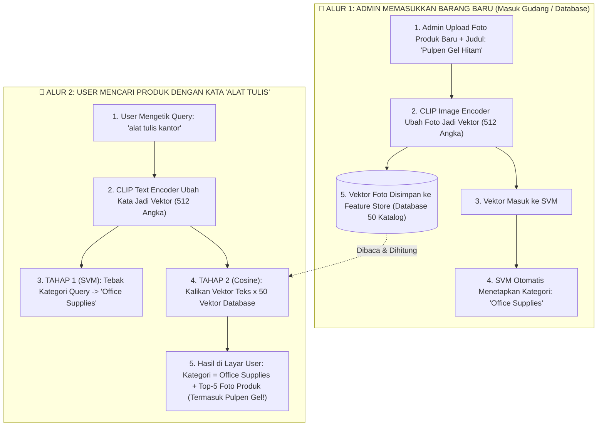

# 📘 RANGKUMAN LENGKAP: ARSITEKTUR MULTIMODAL CLIP & SVM UNTUK RETAIL DORMIY
> **Catatan Panduan Konsep & Alur Kerja Sistem**  
> Ditulis dengan bahasa yang sederhana, analogi nyata, dan matematika dasar berdasarkan hasil diskusi dan eksperimen training.

---

## 📑 DAFTAR ISI
1. [Hakekat Dasar: Apakah CLIP & SVM Punya Akal Pikiran?](#1-hakekat-dasar-apakah-clip--svm-punya-akal-pikiran)
2. [Rahasia Angka: Bagaimana CLIP Mengubah Gambar & Teks Menjadi Vektor 512 Angka](#2-rahasia-angka-bagaimana-clip-mengubah-gambar--teks-menjadi-vektor-512-angka)
3. [Bagaimana Cara Menghubungkan CLIP dan SVM?](#3-bagaimana-cara-menghubungkan-clip-dan-svm)
4. [Bagaimana Cara SVM Tahu Siapa Masuk Kategori Mana?](#4-bagaimana-cara-svm-tahu-siapa-masuk-kategori-mana)
5. [Evaluasi Training: Mengapa Dulu Sempat Drop ke 20% dan Bagaimana Cara Memperbaikinya?](#5-evaluasi-training-mengapa-dulu-sempat-drop-ke-20-dan-bagaimana-cara-memperbaikinya)
6. [Dua Alur Kerja Nyata (Two Distinct Workflows)](#6-dua-alur-kerja-nyata-two-distinct-workflows)
   - [Alur 1: Admin Memasukkan Produk Baru ke Database (Auto-Categorization & Indexing)](#alur-1-admin-memasukkan-produk-baru-ke-database)
   - [Alur 2: Pengguna Mencari Produk Menggunakan Teks (Real-Time Search & Retrieval)](#alur-2-pengguna-mencari-produk-menggunakan-teks)

---

## 1. Hakekat Dasar: Apakah CLIP & SVM Punya Akal Pikiran?

> **Jawabannya: TIDAK! Baik CLIP maupun SVM tidak paham arti kata atau bentuk gambar seperti manusia.**

* **CLIP (Contrastive Language-Image Pretraining)**:
  * Dilatih oleh OpenAI menggunakan **400 juta pasang gambar dan teks** dari internet.
  * CLIP **tidak menyimpan gambar**. CLIP hanyalah sebuah **"penerjemah pintar"**.
  * Jika diberi **Gambar**, CLIP mengeluarkan deretan **512 angka desimal** (disebut *Image Vector*).
  * Jika diberi **Teks**, CLIP juga mengeluarkan deretan **512 angka desimal** (disebut *Text Vector*).
  * Sifat dasarnya adalah **Self-Supervised / Weakly Supervised**: ia belajar sendiri dari teks caption internet tanpa perlu manusia melabeli kategori secara manual.
* **SVM (Support Vector Machine)**:
  * Awalnya **buta total**. SVM tidak tahu apa itu *Stationery*, *Panci*, atau *Hardware*.
  * Sifat dasarnya adalah **Murni Supervised Learning (Terbimbing)**: SVM belajar murni dari data latihan yang **KITA** beri tahu jawabannya (*Ground Truth Label*).

---

## 2. Rahasia Angka: Bagaimana CLIP Mengubah Gambar & Teks Menjadi Vektor 512 Angka?

### Kenapa kata `"Pulpen Gel"` bisa cocok dengan `"Stationery / Alat Tulis"`, padahal katanya berbeda?
Komputer tidak melihat huruf. Komputer mengubah makna kata menjadi deretan 512 angka:
* **Vektor "Black Gel Pen"** = `[-0.0005, 0.0028, -0.0560, 0.0213, ...]`
* **Vektor "Stationery / Writing Tools"** = `[-0.0266, -0.0189, -0.0076, 0.0091, ...]`
* **Vektor "Hardware Power Drill" (Bor)** = `[-0.0259, 0.0002, -0.0264, 0.0030, ...]`

### Bagaimana Cara Komputer Mengujinya? (Perkalian Dot Product)
Komputer mengalikan angka ke-1 dengan ke-1, ke-2 dengan ke-2, lalu menjumlahkan semuanya:
$$\text{Skor Kemiripan} = (A_1 \times B_1) + (A_2 \times B_2) + \dots + (A_{512} \times B_{512})$$

* **Hasil Nyata dari Komputer**:
  * $\text{Pulpen Gel} \times \text{Stationery} = \mathbf{0.7409}$ (Angka Besar $\rightarrow$ **Sangat Cocok!**)
  * $\text{Pulpen Gel} \times \text{Hardware Drill} = \mathbf{0.7081}$ (Angka Lebih Kecil $\rightarrow$ **Kurang Cocok**)

Karena nilainya lebih besar, sistem langsung tahu bahwa pulpen gel jauh lebih berkaitan dengan alat tulis dibanding bor tembok.

---

## 3. Bagaimana Cara Menghubungkan CLIP dan SVM?

Kunci terbesarnya adalah: **Shared Multimodal Space (Satu Ruang yang Sama)**.
* Di model biasa, teks dan gambar memiliki bahasa angka yang berbeda dan tidak bisa disatukan.
* Di CLIP, **vektor teks dan vektor foto dibuat memiliki format koordinat yang sama persis**:
  * Foto anak anjing menghasilkan angka koordinat: `[0.24, -0.51, 0.88, ...]`
  * Tulisan `"anak anjing"` menghasilkan angka koordinat: `[0.23, -0.50, 0.87, ...]`

### Bagaimana SVM Membacanya?
Bagi SVM, ia **tidak peduli** apakah angka itu berasal dari kamera foto atau ketikan keyboard. SVM hanya melihat **512 deret angka**. Karena foto pulpen dan tulisan alat tulis menghasilkan deret angka di koordinat yang sama, **SVM bisa memproses keduanya menggunakan pagar pembatas yang sama!**

---

## 4. Bagaimana Cara SVM Tahu Siapa Masuk Kategori Mana?

### Analogi Pagar Pembatas Lapangan:
1. Setiap produk ditaruh di lapangan luas oleh CLIP berdasarkan bentuk fisiknya:
   * Peralatan makan & dapur berkumpul di sudut barat.
   * Perkakas besi & baut berkumpul di sudut timur.
   * Meja, kursi, dan lemari berkumpul di bagian tengah.
2. **KITA mengajari SVM**:
   * *"Hai SVM, barang-barang di sudut barat ini kami namai kategori **Home & Garden**."*
   * *"Barang-barang di sudut timur kami namai kategori **Hardware**."*
3. **SVM menarik garis pagar pembatas (*Hyperplane*)** yang tegas di antara kelompok-kelompok tersebut.

### Bagaimana jika ada barang baru masuk (misal: Panci Listrik)?
1. CLIP mendeteksi panci punya pegangan, berbahan logam, dan alat masak $\rightarrow$ ditaruh di dekat pisau dan teko (sudut barat).
2. SVM tidak perlu tahu apakah itu namanya panci atau mangkuk. SVM hanya melihat:  
   > *"Titik koordinat barang ini mendarat di dalam zona pagar yang kemarin dinamai manusia sebagai **Home & Garden**."*
3. Maka SVM langsung menetapkan kategorinya: **`Home & Garden`**!

---

## 5. Evaluasi Training: Mengapa Dulu Sempat Drop ke 20% dan Bagaimana Cara Memperbaikinya?

### ❌ Kesalahan di Sesi 1 & 2 (Full Fine-Tuning dengan LR Besar):
* Model CLIP memiliki **151 juta parameter** dan sudah pintar dari 400 juta data internet.
* Kita melatih seluruh 151 juta bobot itu hanya dengan **40 gambar** dan Learning Rate terlalu besar (`0.001`).
* **Akibatnya**: Terjadi *Overfitting* dan *Catastrophic Forgetting* (bobot CLIP rusak dan lupa ingatan). Model mengalami *Mode Collapse* (menebak 1 kategori yang sama terus-menerus), sehingga akurasi anjlok ke $\frac{1}{5} = \mathbf{20\%}$.

### ✅ Keberhasilan di Sesi 3 (Projection-Head Tuning):
* **Kunci (*Freeze*) 99.6% Bobot Asli CLIP** agar kecerdasan dasarnya tidak rusak.
* **Hanya Buka 0.4% Bobot Lapisan Akhir** (`visual_projection` dan `text_projection`).
* **Hasilnya**: Akurasi Top-1 penebakan objek langsung melonjak drastis dari **`56%` $\rightarrow$ `84%`**, dan Top-5 mencapai **`96%`**!

---

## 6. Dua Alur Kerja Nyata (Two Distinct Workflows)

---

### 🏢 ALUR 1: Admin Menambahkan Barang Baru ke Database
* **Tujuan**: Memasukkan barang baru ke sistem tanpa admin harus pusing memilih kategori secara manual (*Auto-Categorization & Indexing*).
1. **Input**: Admin upload foto barang baru (`gambar_pulpen.jpg`) dan judul singkat (*"Pulpen Gel Hitam 0.5mm"*).
2. **Ekstraksi CLIP**: Foto diubah oleh CLIP menjadi **Vektor 512 angka**.
3. **SVM Mengkategorikan**: Vektor tersebut dimasukkan ke SVM. SVM melihat koordinatnya berada di zona alat kantor, lalu memberi label otomatis: **`Office Supplies`**.
4. **Penyimpanan (*Feature Store*)**: Foto, judul, dan vektor 512 angka tersebut disimpan ke dalam database katalog toko Dormiy.

---

### 🛒 ALUR 2: Pengguna Mencari Barang Berdasarkan Teks
* **Tujuan**: Menemukan barang yang relevan meskipun kata yang diketik pengguna tidak sama persis dengan judul barang di database (*Semantic Search & Retrieval*).
1. **Input Pengguna**: Pengguna mengetik kata umum di kotak pencarian:  
   `"alat tulis kantor"` (atau *"stationery writing tools"*).
2. **Ekstraksi CLIP**: CLIP Text Encoder mengubah kalimat itu menjadi **Vektor 512 angka**.
3. **Tahap 1 — SVM Memprediksi Kategori Terlebih Dahulu**:
   * Vektor teks langsung dimasukkan ke SVM.
   * SVM mengeluarkan kategori: **`Office Supplies`** (Confidence: 85%).
   * Sistem memberi tahu pengguna kategori yang relevan dengan pencariannya.
4. **Tahap 2 — Cosine Similarity Menemukan Produk Spesifik**:
   * Vektor teks dikalikan (*dot product*) dengan seluruh vektor gambar yang ada di database (termasuk foto pulpen gel yang dimasukkan admin pada Alur 1).
   * Produk diurutkan berdasarkan skor perkalian tertinggi.
5. **Output ke Layar Pengguna**:
   * **Kategori Terdeteksi**: `Office Supplies`
   * **Top 1 Produk Rekomendasi**: Foto & judul *"Pulpen Gel Hitam 0.5mm"* (Meskipun pengguna tidak mengetik kata "pulpen").
   * **Top 2 - 5**: Produk alat tulis lain yang mirip (misal: stapler, kertas, binder clip).

---

### 📌 Ringkasan Eksekutif 1 Paragraf
> **Kategori ritel ditentukan oleh kita sendiri**. CLIP bertindak sebagai mesin penerjemah universal yang mengubah foto dan teks menjadi bahasa angka (vektor 512 dimensi). SVM bertindak sebagai polisi pembatas yang menghafal batas kategori toko berdasarkan koordinat angka tersebut. Saat pengguna mencari barang dengan kata apa pun, CLIP membaca maknanya, SVM langsung menebak kategorinya, dan Cosine Similarity menarik 5 foto produk paling mirip dari database toko Anda secara instan.

